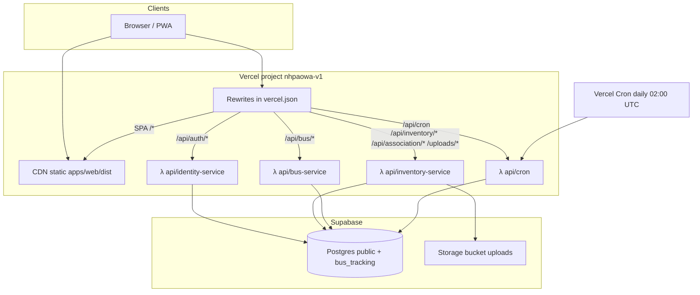
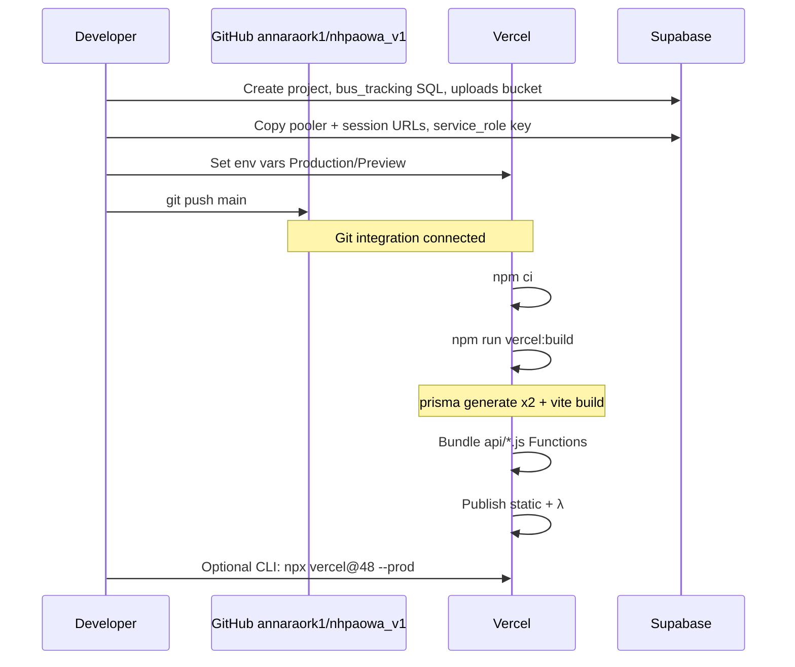

# Deploy on Vercel (fullstack)

This document describes how NHPAOWA is deployed to **Vercel** with **Supabase** (Postgres + Storage). Production example: [https://nhpaowa-v1.vercel.app](https://nhpaowa-v1.vercel.app).

Related: [DEPLOY-DOCKER.md](./DEPLOY-DOCKER.md) · [site/installation/supabase.md](../site/installation/supabase.md) · [site/installation/vercel-hosting.md](../site/installation/vercel-hosting.md)

---

## Architecture

One Vercel project serves the **Vite SPA** (static) and four **Node serverless functions** that wrap the existing Express apps. Data and files live on **Supabase**, not on the Vercel filesystem.



### Request path map

| Browser path | Vercel destination | Implementation |
|--------------|--------------------|----------------|
| `/` and client routes | `apps/web/dist` → `index.html` | Vite SPA + PWA |
| `/api/auth/*` | `/api/identity-service` | Express identity (`services/identity-service`) |
| `/api/inventory/*`, `/api/association/*` | `/api/inventory-service` | Express inventory + association |
| `/uploads/*` | `/api/inventory-service` | Signed redirect to Supabase Storage |
| `/api/bus/*` | `/api/bus-service` | Express bus |
| `/api/cron` | `/api/cron` | Inventory + bus scheduled jobs |

Frontend uses **relative** `VITE_*` bases (`/api/inventory`, `/api/auth`, …) so the browser stays same-origin.

---

## Deploy flow



### Build command

Defined in [`vercel.json`](../vercel.json) and [`package.json`](../package.json):

```bash
npm run vercel:build
# → prisma generate (inventory) + prisma generate (bus) + vite build (web)
```

- **Install:** `npm ci` (workspace monorepo at repo root)
- **Output:** `apps/web/dist`
- **Functions:** `api/**/*.js` with `includeFiles` for `services/`, `packages/`, Prisma clients (`maxDuration` 60s)

Prefer **Vercel CLI 48.x** for manual deploys from this monorepo (`npx vercel@48.12.1 --prod`). CLI 65+ may force a multi-`services` schema that conflicts with this layout.

---

## Configuration

### `HOSTING_MODE`

| Value | Meaning |
|-------|---------|
| `vercel-fullstack` | APIs on Vercel Functions; uploads → Supabase Storage; jobs → Cron (no `setInterval`) |
| `vercel-spa` | SPA only; APIs on Docker/VPS (see generator script) |
| `docker` | Local / Compose (see [DEPLOY-DOCKER.md](./DEPLOY-DOCKER.md)) |

Generate rewrite-heavy config when needed:

```bash
HOSTING_MODE=vercel-fullstack npm run vercel:config
```

### Environment variables (Vercel project)

Set in **Vercel → Project → Settings → Environment Variables** (Production + Preview). Do not commit secrets.

| Variable | Purpose |
|----------|---------|
| `HOSTING_MODE` | `vercel-fullstack` |
| `DATABASE_URL` | Supabase **Transaction** pooler (`:6543`) + `?pgbouncer=true&connection_limit=1` |
| `DATABASE_URL_UNPOOLED` | Session pooler (`:5432` on pooler host) or Direct — for Prisma `directUrl` / migrations |
| `JWT_SECRET` | Shared JWT signing secret (long random) |
| `AUTH_STRICT` | `true` in production |
| `ASSOCIATION_ID` | Tenant UUID (no trailing whitespace) |
| `SUPABASE_URL` | `https://<ref>.supabase.co` |
| `SUPABASE_SERVICE_ROLE_KEY` | Service role (server only) |
| `SUPABASE_STORAGE_BUCKET` | `uploads` |
| `STORAGE_BACKEND` | `supabase` |
| `CRON_SECRET` | Bearer token for `/api/cron` (no leading/trailing spaces) |
| `VITE_API_BASE_URL` | `/api/inventory` |
| `VITE_IDENTITY_BASE_URL` | `/api/auth` |
| `VITE_BUS_BASE_URL` | `/api/bus` |
| `VITE_ASSOCIATION_BASE_URL` | `/api/association` |

`VITE_*` are baked in at **build** time — change them → redeploy.

### Cron

Hobby plan: **one run per day**.

```json
{ "path": "/api/cron?job=all", "schedule": "0 2 * * *" }
```

Calls inventory PO/AMC scan + bus alert scan. More frequent bus polling needs Pro (or keep Docker for always-on `setInterval`).

### Key repo files

| Path | Role |
|------|------|
| `vercel.json` | Build, rewrites, cron, function includes |
| `api/identity-service.js` | Serverless entry → Express identity |
| `api/inventory-service.js` | Serverless entry → Express inventory |
| `api/bus-service.js` | Serverless entry → Express bus |
| `api/cron.js` | Scheduled jobs entry |
| `scripts/generate-vercel-config.mjs` | Emit `vercel.json` from `HOSTING_MODE` |
| `scripts/supabase-init.sql` | Create `bus_tracking` (never create `auth`) |
| `package.json` → `vercel:build` | Prisma generate + web build |

---

## One-time Supabase setup

1. Create project → run `scripts/supabase-init.sql` in SQL Editor.
2. Create Storage bucket `uploads` (private is fine; API issues signed URLs).
3. From a laptop with `.env` pointing at Supabase:

```bash
npx prisma db push --schema=services/inventory-service/prisma/schema.prisma
npm run db:seed
npm run db:bus:push
npm run db:bus:seed
```

Use **session/direct** URL for push if Transaction pooler errors.

---

## Connect GitHub → Vercel

1. Repo: [github.com/annaraork1/nhpaowa_v1](https://github.com/annaraork1/nhpaowa_v1)
2. Vercel project linked with Git (`vercel git connect` or Dashboard → Git).
3. Ensure env vars exist for Production/Preview.
4. Push to `main` → automatic Production deploy (or deploy manually with CLI 48).

---

## Making API responses faster

The UI now shows a **global progress bar** and per-page **Loading…** / button pending states while requests run. That does not remove network latency — it makes waits visible. To actually speed up reads/writes:

### 1. Colocate Vercel Functions with Supabase (biggest win)

Your Supabase project is in **`ap-northeast-2` (Seoul)**. Early deploys ran Functions in **`iad1` (US East)** — often **150–250ms+ RTT per DB round-trip**.

[`vercel.json`](../vercel.json) sets:

```json
"regions": ["hnd1"]
```

Tokyo (`hnd1`) is much closer to Seoul than Virginia. After deploy, confirm in the Vercel dashboard that Functions run in **hnd1**. If Vercel offers **`icn1` (Seoul)**, prefer that.

Also set Supabase region and Vercel region in the same geography for new projects.

### 2. Keep using the Transaction pooler

`DATABASE_URL` must stay on the **pooler `:6543`** with `pgbouncer=true&connection_limit=1`. Direct connections from many cold Functions exhaust Postgres slots and feel like hangs.

### 3. Reduce cold starts

- **Fluid Compute / longer keepalive** (Vercel Pro): keeps isolates warmer.
- Avoid huge Function bundles: `includeFiles` already scopes Prisma; don’t add unused deps to API paths.
- Prefer fewer waterfall queries on a page (dashboard currently fires several `useQuery`s — consider a single aggregated endpoint later).

### 4. Caching & query UX (already partial)

- TanStack Query `staleTime: 30s` reduces refetch chatter (`main.jsx`).
- Raise `staleTime` for stable lists (categories, warehouses) if acceptable.
- Prefer `placeholderData` / keep previous data on filter changes (pattern already used on some Flats/Items views).

### 5. Database-side

- Ensure indexes exist for hot filters (associationId + status, flat search).
- Avoid N+1 Prisma includes on large lists; paginate (Flats already does).
- Watch Supabase dashboard for slow queries.

### 6. When Docker is faster

Always-on Express on a VPS next to Postgres (or Docker Compose on LAN) avoids cold starts and supports sub-minute bus jobs. See [DEPLOY-DOCKER.md](./DEPLOY-DOCKER.md).

---

## Operational notes

- **Auth** is app JWT (`JWT_SECRET`), not Supabase Auth.
- **Uploads** are not stored on Vercel disk; they go to Supabase Storage when `HOSTING_MODE=vercel-fullstack`.
- **Prisma** uses a singleton client per Function to reduce pool exhaustion.
- After rotating Supabase keys/passwords, update Vercel env and redeploy.
- Demo seed passwords (`password123`) must be changed for real associations.
- UI loading: `GlobalProgress` in Shell + `QueryStatus` / `pendingLabel` on list and form pages.

---

## Quick checklist

- [ ] Supabase schemas + seed applied  
- [ ] Vercel env vars set (trimmed, no newlines)  
- [ ] GitHub connected to Vercel project  
- [ ] `vercel.json` + `api/*` on `main`  
- [ ] Smoke test: `POST /api/auth/login` → 200  
- [ ] Open https://\<project\>.vercel.app and use Quick demo login  
