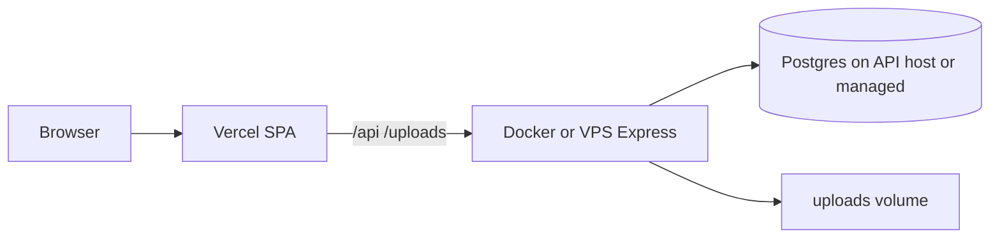

# Vercel hosting (modes A / B)

The same repo can deploy in different ways via **`HOSTING_MODE`**. This is a **deploy-time** switch (env + rebuild), not a toggle in the running app.

| Mode | Value | Frontend | Backend | Database |
|------|--------|----------|---------|----------|
| Local / on-prem (default) | `docker` | Vite or Docker nginx | Express `listen()` on Docker/VPS | Postgres in Compose (or your own server) |
| **A** — SPA on Vercel | `vercel-spa` | Vercel static | Express stays on Docker/VPS | **Same DB as the API host** — not on Vercel |
| **B** — full stack on Vercel | `vercel-fullstack` | Vercel static | Vercel Functions (`api/*`) | **Supabase Postgres** (pooled + direct URLs) + Storage for uploads |

Generate Vercel config:

```bash
# Mode A or B — put HOSTING_MODE (and upstreams for A) in .env, then:
npm run vercel:config
```

Examples:

```bash
HOSTING_MODE=vercel-spa API_PROXY_ORIGIN=https://your-api-host.example.com npm run vercel:config
HOSTING_MODE=vercel-fullstack npm run vercel:config
```

For Supabase provisioning steps see [Supabase database](/installation/supabase).

## Database — how it is managed

Postgres is **not** replaced by Vercel Blob or env vars. Every mode still uses the same Prisma schemas (`public` for inventory/association/identity; `bus_tracking` for bus).

### `docker` (and Windows/Linux native installs)

- Run Postgres locally (`npm run db:up` / Compose) or on your LAN server.
- Set `DATABASE_URL` in root `.env`.
- Create schemas once (Compose runs `docker/init-schemas.sql` on first start; native installs need `bus_tracking` etc. — see [Command Line](/administration/command-line)).
- Migrate / seed from the machine that can reach the DB:

```bash
npm run db:migrate
npm run db:seed
npm run db:bus:push
npm run db:bus:seed
```

- Backups: dump Postgres + the `uploads/` volume/folder.

### `vercel-spa` (mode A) — **recommended next step**

- The **API host** owns the database. Vercel only serves the SPA (and optionally rewrites `/api/*` to that host).
- Point `DATABASE_URL` on the **API server** (Docker/VPS `.env`), not in the Vercel project (unless you also run migrations from CI against that URL).
- Schema changes: run Prisma migrate/push from CI or an admin machine against that same `DATABASE_URL`.
- Uploads stay on the API host disk (or a volume). Vercel does not store them.



### `vercel-fullstack` (mode B)

- Provision **Supabase** Postgres — see [Supabase database](/installation/supabase).
- Create `bus_tracking` with `scripts/supabase-init.sql` (never create an `auth` schema).
- Use two URLs:
  - **Pooled** `DATABASE_URL` — Transaction pooler `:6543` + `?pgbouncer=true&connection_limit=1`
  - **Direct** `DATABASE_URL_UNPOOLED` — `db.…supabase.co:5432` for Prisma push/migrate
- Uploads use **Supabase Storage** bucket `uploads` (`SUPABASE_URL`, `SUPABASE_SERVICE_ROLE_KEY`).
- Jobs use **Vercel Cron** → `/api/cron` (set `CRON_SECRET`). In-process `setInterval` is disabled in this mode.
- Run `npm run vercel:config` with `HOSTING_MODE=vercel-fullstack`, then deploy.

## Mode A checklist (SPA on Vercel)

1. APIs + Postgres running on Docker/VPS with HTTPS (or a tunnel for trials).
2. In Vercel project env (Production):
   - `HOSTING_MODE=vercel-spa`
   - Either:
     - **Same-origin:** `API_PROXY_ORIGIN` (or `IDENTITY_UPSTREAM` / `INVENTORY_UPSTREAM` / `BUS_UPSTREAM`) and relative `VITE_*` (`/api/inventory`, `/api/auth`, `/api/bus`, …), then run `npm run vercel:config` before deploy (or as part of CI), **or**
     - **Absolute:** set `VITE_API_BASE_URL`, `VITE_IDENTITY_BASE_URL`, `VITE_BUS_BASE_URL`, etc. to `https://your-api-host/...` and keep SPA-only `vercel.json`.
3. Build uses root `npm ci` + `npm run build -w @nhpaowa/web` (see committed `vercel.json` at the repo root).
4. Confirm CORS on the API host if you use absolute `VITE_*` cross-origin URLs.

## Related

- [Configuration](/administration/configuration) — full env table including `HOSTING_MODE`
- [Reverse Proxy](/installation/reverse-proxy) — path layout nginx already uses (`/api/auth`, `/api/inventory`, …)
