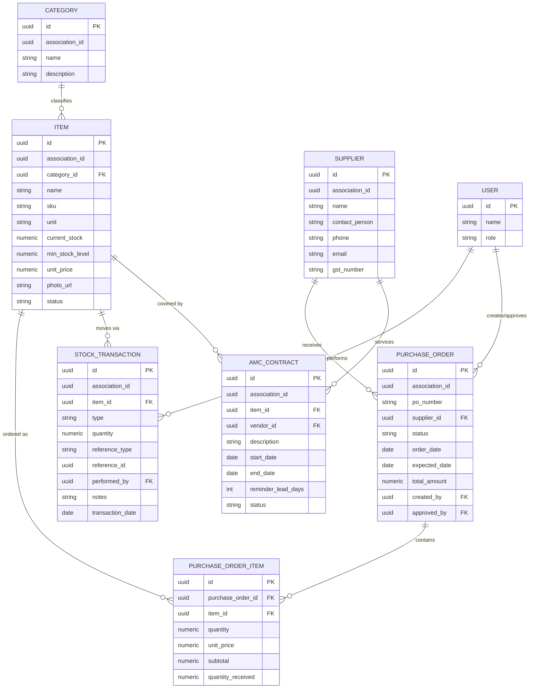

# ERD: NHPAOWA Inventory Management Module

**Related:** `specs/001-inventory-management/plan.md` §4 (source of truth
for field-level detail); this doc is the visual/reference companion.

## 1. Entity List (summary)

| Entity | Purpose | Key Fields |
|---|---|---|
| **Category** | Classifies Items | name, description |
| **Item** | A stocked good | name, sku, unit, current_stock, min_stock_level, unit_price, status (computed) |
| **Supplier** | Vendor supplying Items | name, contact_person, phone, email, gst_number |
| **PurchaseOrder** | An order placed with a Supplier | po_number, status, order_date, expected_date, total_amount |
| **PurchaseOrderItem** | Line item within a PO | quantity, unit_price, subtotal, quantity_received |
| **StockTransaction** | Immutable record of stock movement | type (IN/OUT), quantity, reference_type, transaction_date |
| **AmcContract** | Annual Maintenance Contract on an asset | vendor, start_date, end_date, reminder_lead_days, status |
| **Alert** | System-generated notification | type, severity, related_entity, is_read |
| **User** *(shared platform entity, not owned by this module)* | Performs actions, approves POs | name, role |

All entities carry `association_id` (tenant scoping) and standard
`created_at`/`updated_at` (soft-delete `deleted_at` on master data:
Category, Item, Supplier).

## 2. Relationships (plain-language)

- One **Category** has many **Items**.
- One **Supplier** has many **Purchase Orders**.
- One **Purchase Order** has many **Purchase Order Items**; each Purchase
  Order Item points to one **Item**.
- One **Item** has many **Stock Transactions**.
- One **Item** may have many **AMC Contracts** (nullable — only
  asset-tracked items like fire extinguishers need one).
- One **Supplier** may service many **AMC Contracts**.
- One **User** performs many **Stock Transactions** and creates/approves
  many **Purchase Orders**.
- **Alerts** reference any of the above entities polymorphically via
  `related_entity_type` + `related_entity_id`.

## 3. Diagram (Mermaid ER syntax — renders in GitHub, Cursor, and most
Markdown previewers)

## 4. Notes for Implementation
- `Item.status` and `PurchaseOrder.total_amount` are **computed**, not
  stored as independently-writable fields — see `plan.md` §4 "Derived /
  Computed" for the exact formulas.
- `StockTransaction` has no `updated_at`/`deleted_at` by design — it is
  append-only, per the platform Constitution's audit principle (§2.5).
- `Alert` is shown here for completeness but is expected to live in the
  shared platform notification service/table (Constitution §2.6), not a
  separate Inventory-owned table.
